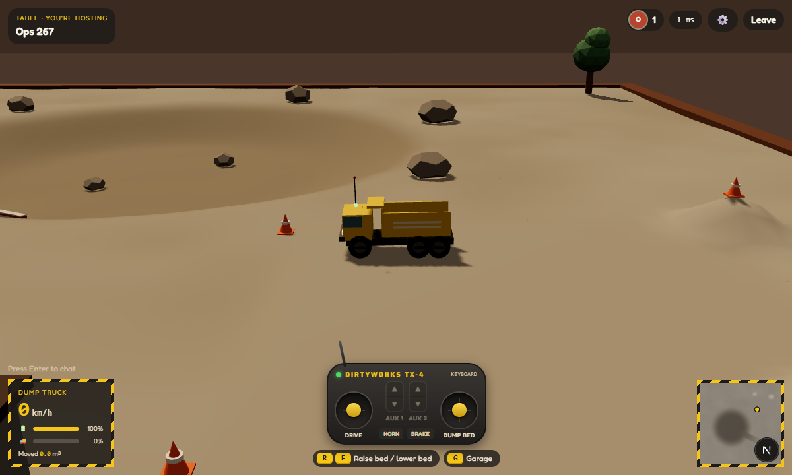
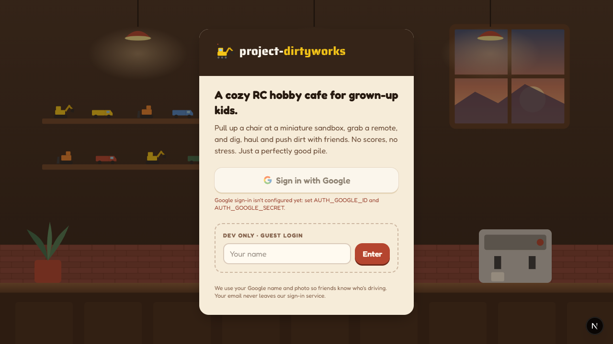
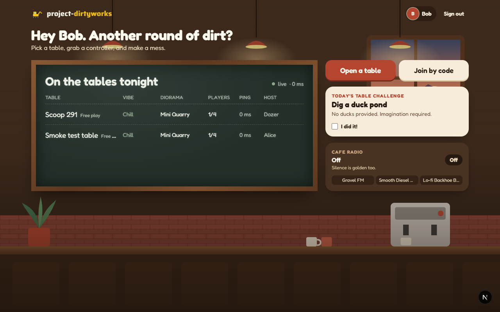
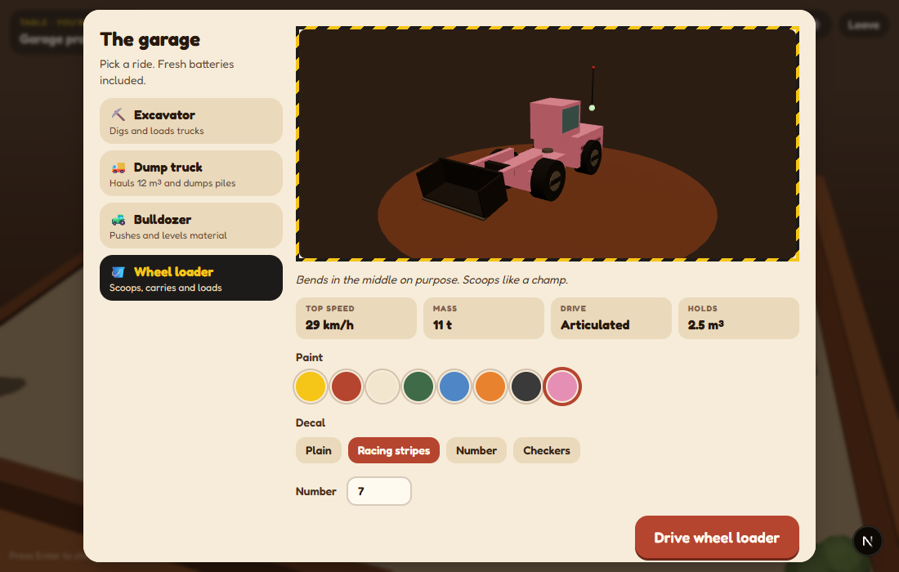
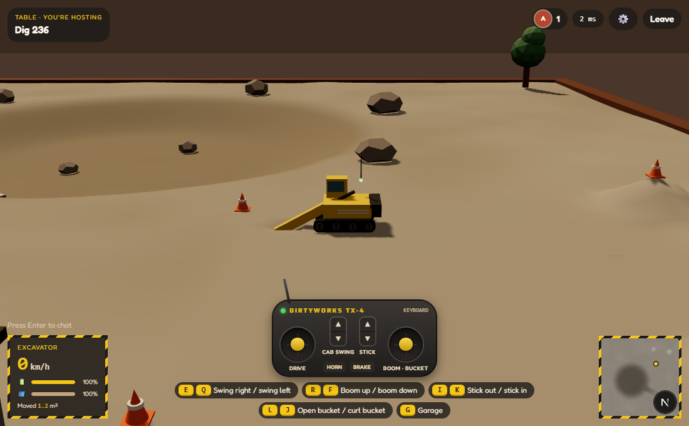
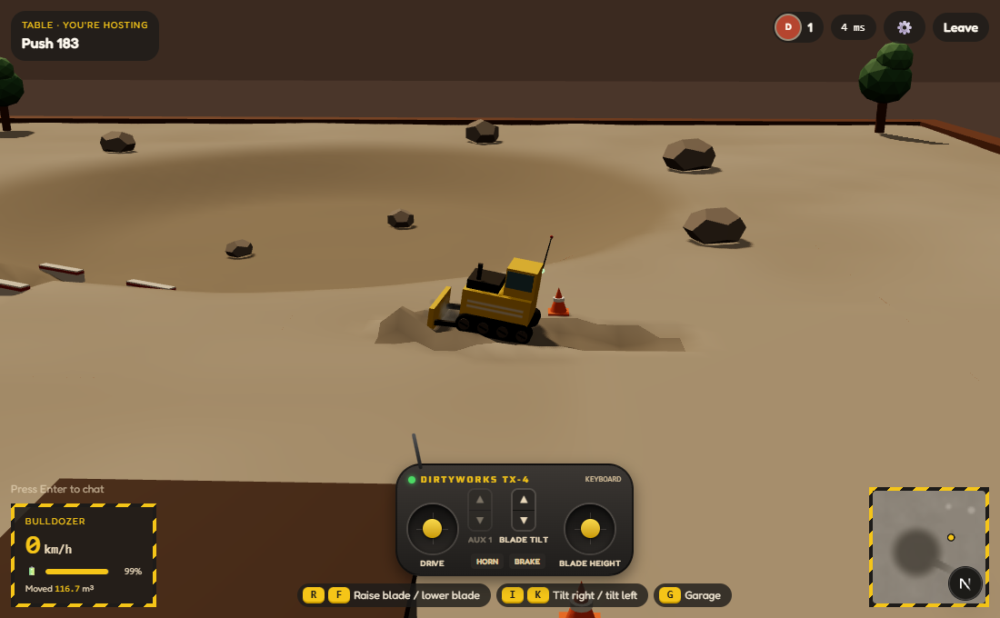
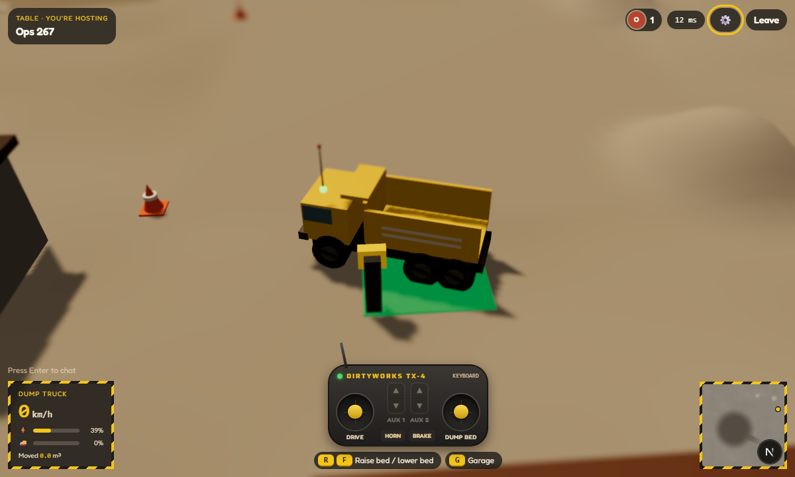
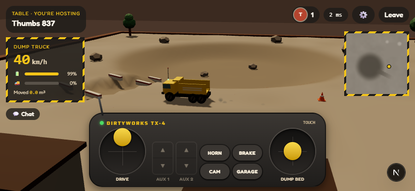

# project-dirtyworks

**A cozy online RC hobby cafe for grown-up kids.** Sign in, walk into an illustrated cafe, pick a
_table_ (a miniature sandbox diorama) from the chalkboard, and drive remote-control construction
vehicles together. Excavators and wheel loaders dig, dump trucks haul, bulldozers push, and every
player at the table sees the same vehicles and the same terrain in real time. No scores, no
pressure. Just a perfectly good pile.



## Screenshots

|                                                                                                    |                                                                                                           |
| -------------------------------------------------------------------------------------------------- | --------------------------------------------------------------------------------------------------------- |
|   |        |
| **Landing.** Sign in with Google (or the dev-only guest login).                                    | **The cafe.** Live chalkboard of open tables, daily challenge, radio.                                     |
|  |          |
| **The garage.** Pick a vehicle and paint it.                                                       | **Digging.** Close the bucket below ground to fill it.                                                    |
|                      |  |
| **Pushing.** Lower the blade and drive forward.                                                    | **Tilt-shift and charging.** Park on the green pad to top up.                                             |
|         |                                                                                                           |
| **Touch.** On phones and tablets the transmitter is the controller.                                |                                                                                                           |

## How it works (a quick tour)

1. **Sign in.** Google sign-in uses your Google display name and photo so friends know who is
   driving. Your email is never shown or sent to the game server. For local development there is
   a guest login (just type a name).
2. **Pick a table in the cafe.** The chalkboard lists open tables live (name, vibe, diorama,
   players, ping, host). You can:
   - **Open a table**: name it, pick a diorama (Mini Quarry, Backyard Sandbox, Construction Yard,
     Beach Dig Site), a ground material (sand, gravel, damp dirt), a vibe and a house rule, set
     2–8 driver seats and an optional password. You become the host.
   - **Join by code**: every table has a short invite code.
   - **Full table?** Spectate, or wait and get told when a seat opens.
3. **Choose a vehicle in the garage.** Excavator, dump truck, bulldozer or wheel loader, with a
   paint color, decal and number (your livery is remembered and synced to everyone).
4. **Drive from the operator's spot.** By default you see the table the way an RC driver does,
   standing at the table's edge. Your operator walks along the rim to stay close to your vehicle.
   Press **V** for the chase cam or a free orbit camera.
5. **Dig, haul, push.**
   - _Excavator / wheel loader:_ lower the bucket below the ground and curl it closed to fill it;
     open it above a truck bed (or anywhere) to drop the load.
   - _Dump truck:_ get loaded, drive off, and raise the bed past 40° to dump a pile.
   - _Bulldozer:_ lower the blade to the ground and drive forward to push material into a windrow.

   Terrain changes are shared with everyone at the table, including people who join later.

6. **Mind the battery.** It drains as you drive and work the hydraulics. Below 20% your top speed
   drops (it never stops you). Park on a green **charging pad** to recharge. The status LED on the
   antenna mount shows green (ok), blue blinking (hydraulics busy), amber (low) or pulsing green
   (charging).
7. **Hang out.** Chat (Enter), see who's here (Tab), share the invite code from the table menu,
   and mute or report someone. Hosts can also kick or ban players, dim the lights, and close the
   table.

## Controls

| Action                           | Keyboard              | Gamepad (standard mapping)                      | Touch                  |
| -------------------------------- | --------------------- | ----------------------------------------------- | ---------------------- |
| Drive / steer                    | W A S D or arrow keys | Left stick                                      | Transmitter left stick |
| Handbrake                        | Space                 | A / Cross                                       | BRAKE button           |
| Tool axes                        | Q/E, R/F, I/K, J/L    | Triggers, right stick Y, bumpers, right stick X | Rockers + right stick  |
| Horn                             | H                     | Y / Triangle                                    | HORN button            |
| Camera (operator → chase → free) | V                     | Right stick click                               | CAM button             |
| Garage                           | G                     | Start                                           | GARAGE button          |
| Chat                             | Enter                 |                                                 | Chat button            |
| Player list                      | Tab                   | Back / Select                                   | Player avatars         |
| Perf overlay                     | F3                    |                                                 |                        |
| Close menus                      | Esc                   |                                                 |                        |

The bottom of the screen always shows the keys for the vehicle you're driving:

| Vehicle      | Tool keys                                                               |
| ------------ | ----------------------------------------------------------------------- |
| Excavator    | Q/E cab swing, R/F boom up/down, I/K stick out/in, L/J open/curl bucket |
| Dump truck   | R/F raise/lower bed                                                     |
| Bulldozer    | R/F raise/lower blade, I/K tilt blade                                   |
| Wheel loader | R/F raise/lower arm, I/K tilt back/dump bucket                          |

Settings (⚙️) cover graphics quality, the tilt-shift "miniature" effect, sound volume and camera
sensitivity. Sounds come from a tiny built-in synthesizer (horn, motor hum, servo whine, digging,
cafe room tone) and start after your first click or key press.

## Running it locally

**Requirements:** Node.js 22.12 or newer (developed on Node 24) and npm 11.

```bash
npm install
cp .env.example apps/web/.env.local   # then keep only the web section
cp .env.example apps/server/.env      # then keep only the server section
npm run dev                           # web on http://localhost:3000, game server on :2567
```

Fill in the env files:

| File                  | Variable                                           | Value                                                        |
| --------------------- | -------------------------------------------------- | ------------------------------------------------------------ |
| `apps/web/.env.local` | `AUTH_SECRET`                                      | Any random string (`npx auth secret`)                        |
|                       | `GAME_JWT_SECRET`                                  | Random string, 32+ characters. **Same value in both files.** |
|                       | `NEXT_PUBLIC_GAME_SERVER_URL`                      | `http://localhost:2567`                                      |
|                       | `AUTH_DEV_LOGIN`                                   | `true` to enable the guest login (ignored in production)     |
|                       | `AUTH_GOOGLE_ID`, `AUTH_GOOGLE_SECRET`             | Optional: Google OAuth client                                |
| `apps/server/.env`    | `GAME_JWT_SECRET`                                  | Same as the web app                                          |
|                       | `PORT`, `ALLOWED_ORIGINS`, `DATA_DIR`, `LOG_LEVEL` | Defaults in `.env.example` work                              |

**Google sign-in (optional):** create an OAuth client (type "Web application") in Google Cloud
Console → APIs & Services → Credentials, and add the redirect URI
`http://localhost:3000/api/auth/callback/google` (plus your production URL's equivalent).

**Trying multiplayer on one machine:** with `AUTH_DEV_LOGIN=true`, open a second browser (or a
private window), sign in as a different guest and join the same table from the chalkboard.

### Scripts

| Command             | What it does                                             |
| ------------------- | -------------------------------------------------------- |
| `npm run dev`       | Web (Next.js) and game server (Colyseus) with hot reload |
| `npm test`          | All unit and integration tests (shared, server, web)     |
| `npm run typecheck` | TypeScript in every workspace                            |
| `npm run lint`      | ESLint                                                   |
| `npm run format`    | Prettier                                                 |
| `npm run build`     | Production builds of every workspace                     |

## Project layout

```
apps/
  web/       Next.js 16 app: landing, cafe, table page, HUD, and the 3D game
             (three.js + React Three Fiber + Rapier physics)
  server/    Colyseus game server: lobby and table rooms, terrain authority,
             movement validation, moderation, saved tables
packages/
  shared/    Game rules used by both sides: vehicles, maps, terrain, messages,
             movement checks, rate limits, liveries, emotes, battery
docs/
  screenshots/
  superpowers/  Design spec and implementation plan
```

## Under the hood

- **Networking.** Each table is a Colyseus room. Players own their vehicle's movement and send
  their state 20 times a second; the server checks every update against the vehicle's limits
  (speed, acceleration, teleports) and snaps cheaters back. Everyone else's vehicles are drawn
  from a 100 ms interpolation buffer.
- **Terrain.** A chunked, deterministic heightmap (1/1024 m steps, integer brush math). Players
  send _intents_ (dig, release, dump, push); the server validates them, applies them in order,
  and broadcasts numbered ops. Clients replay the ops and check the result, so every screen stays
  identical. Late joiners get a compressed snapshot plus the ops since. Material slumps to its
  angle of repose, and volume is conserved.
- **Game loop.** One frame loop with named phases (inputs → vehicle → physics → network →
  terrain → camera → visuals → audio → render). Physics (Rapier) is stepped manually at ~60 Hz.
- **Auth.** Auth.js (Google) on the web side mints a short-lived game token that the game server
  verifies. Only the Google display name and avatar are shared with other players.

## Status

Built so far: sign-in, the cafe and table browser, table creation (passwords, invite codes,
limits), the four vehicles with physics, multiplayer driving, chat, the garage and liveries, host
moderation, shared terrain digging/hauling/pushing, the minimap and perf overlay, the operator
camera, the RC transmitter (including touch), battery and charging, sound, and tilt-shift.

In progress: emotes (keys 1–5) shown above each player's spot on the rim, nameplates, a spectator
bar for switching between drivers, and photo mode (P).

Planned next: ground-material looks and track marks, host buttons for resetting the terrain and
keeping a table for later (the server already supports both), reopening saved tables from the
cafe, daily challenge polish, deployment notes and a Dockerfile for the game server.

## Privacy

- Emails are never displayed or sent to the game server.
- Avatars are only loaded from Google's image hosts, with an initials fallback.
- Players can mute and report others; hosts can kick and ban for the rest of the session.
