# project-dirtyworks

**A cozy online RC hobby cafe for grown-up kids.** Sign in, walk into an illustrated cafe, pick a
_table_ (a miniature sandbox diorama) from the chalkboard, and drive remote-control construction
vehicles together. Excavators and wheel loaders dig, dump trucks haul, bulldozers push, and every
player at the table sees the same vehicles and the same terrain in real time. No scores, no
pressure. Just a perfectly good pile.

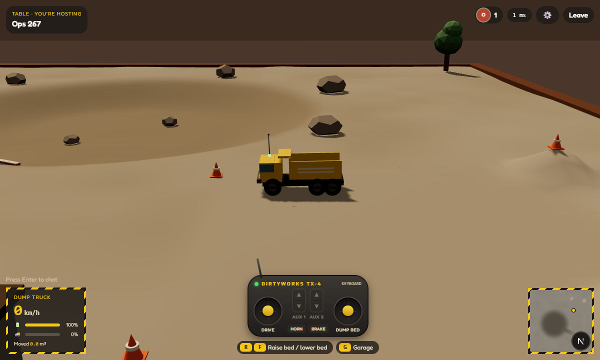

## Screenshots

|                                                                                                           |                                                                                                           |
| --------------------------------------------------------------------------------------------------------- | --------------------------------------------------------------------------------------------------------- |
| 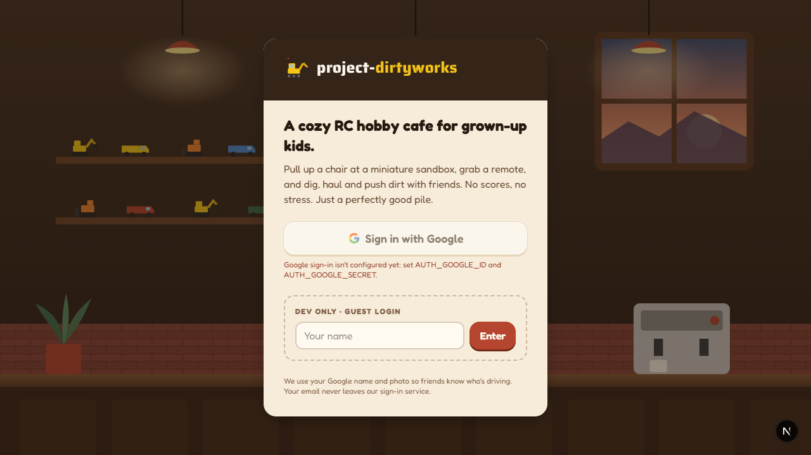         | 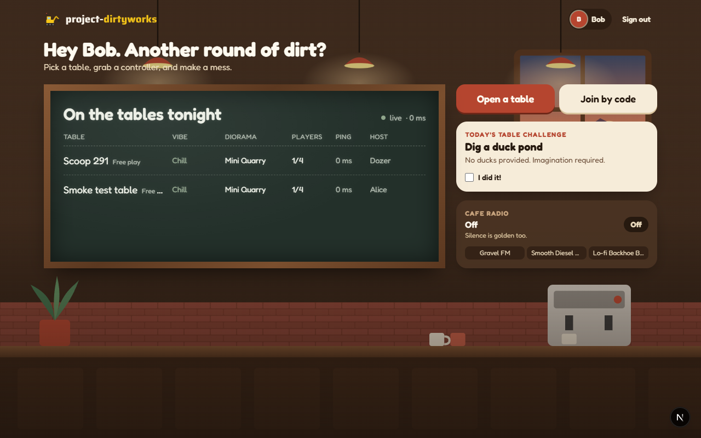       |
| **Landing.** Sign in with Google (or the dev-only guest login).                                           | **The cafe.** Live chalkboard of open tables, daily challenge, radio.                                     |
| 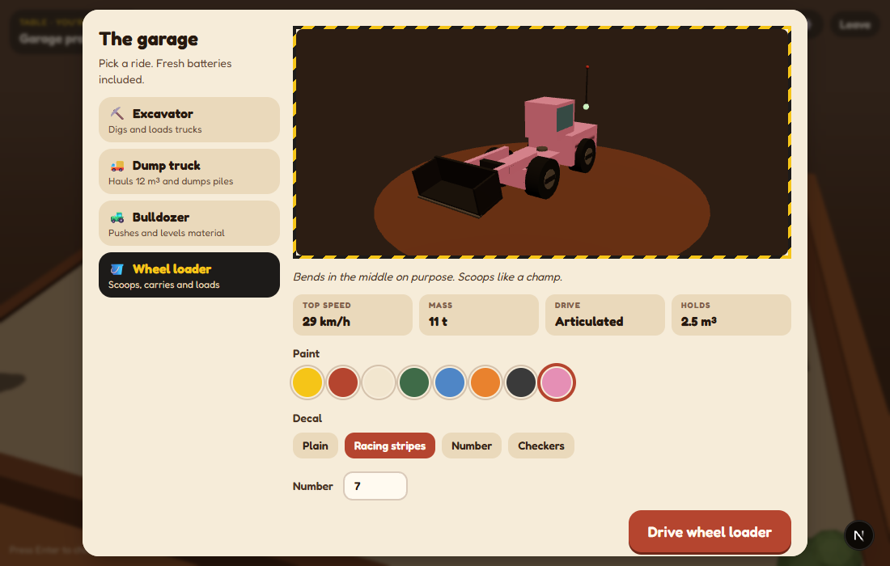        | 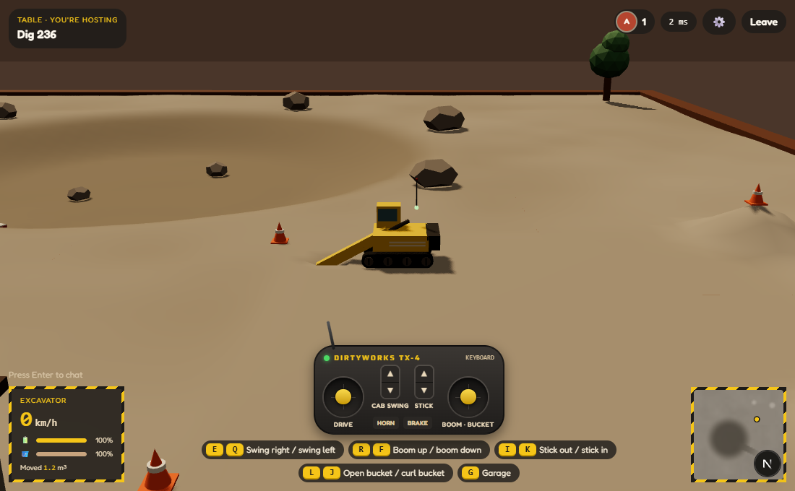         |
| **The garage.** Pick a vehicle and paint it.                                                              | **Digging.** Close the bucket below ground to fill it.                                                    |
| 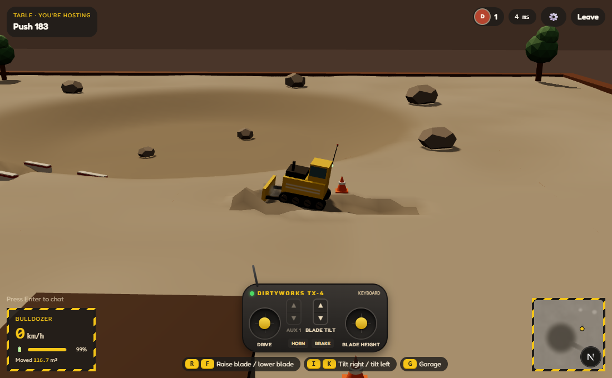                            | 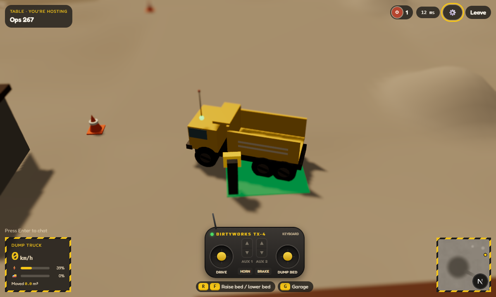 |
| **Pushing.** Lower the blade and drive forward.                                                           | **Tilt-shift and charging.** Park on the green pad to top up.                                             |
| 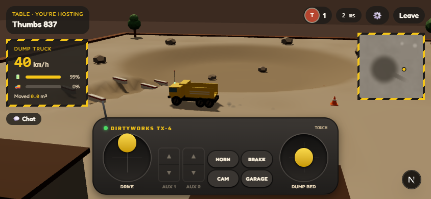               | 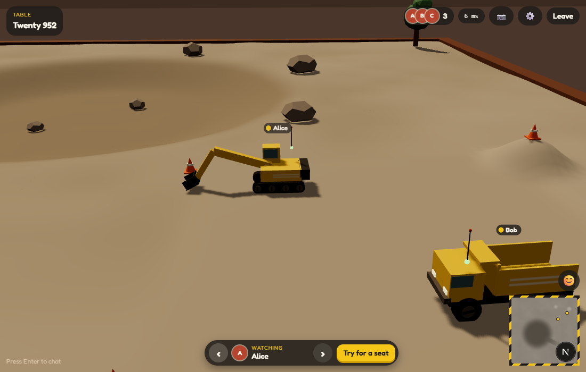     |
| **Touch.** On phones and tablets the transmitter is the controller.                                       | **Spectating.** Switch drivers with ← / →, or try for a seat.                                             |
| 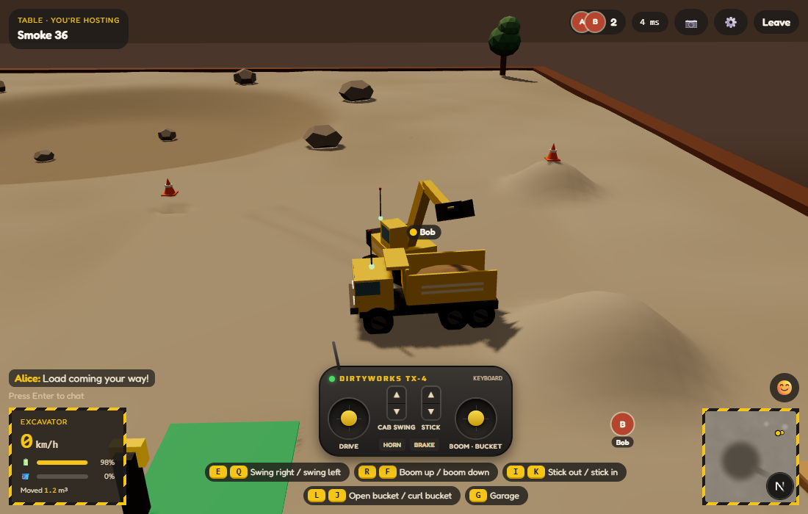 | 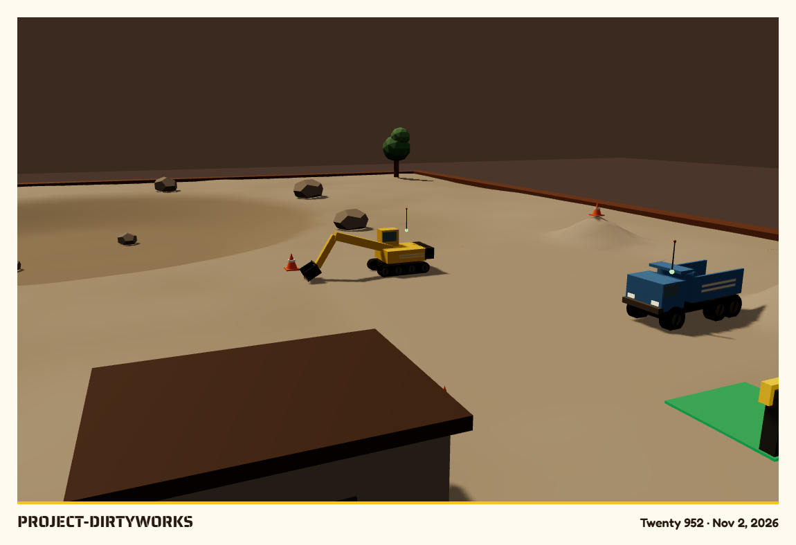    |
| **Loading a truck.** Open the bucket over the bed.                                                        | **Photo mode.** P hides the HUD and saves a framed PNG.                                                   |

## How it works (a quick tour)

1. **Sign in.** Google sign-in uses your Google display name and photo so friends know who is
   driving. Your email is never shown or sent to the game server. For local development there is
   a guest login (just type a name).
2. **Pick a table in the cafe.** The chalkboard lists open tables live (name, vibe, diorama,
   players, ping, host). You can:
   - **Open a table**: name it, pick a diorama (Mini Quarry, Backyard Sandbox, Construction Yard,
     Beach Dig Site), a ground material (sand, gravel, damp dirt), a vibe and a house rule, set
     2–8 driver seats and an optional password. You become the host.
   - **Join by code**: every table has a short invite code.
   - **Full table?** Spectate, or wait and get told when a seat opens.
3. **Choose a vehicle in the garage.** Excavator, dump truck, bulldozer or wheel loader, with a
   paint color, decal and number (your livery is remembered and synced to everyone).
4. **Drive from the operator's spot.** By default you see the table the way an RC driver does,
   standing at the table's edge. Your operator walks along the rim to stay close to your vehicle.
   Press **V** for the chase cam or a free orbit camera.
5. **Dig, haul, push.**
   - _Excavator / wheel loader:_ lower the bucket below the ground and curl it closed to fill it;
     open it above a truck bed (or anywhere) to drop the load.
   - _Dump truck:_ get loaded, drive off, and raise the bed past 40° to dump a pile.
   - _Bulldozer:_ lower the blade to the ground and drive forward to push material into a windrow.

   Terrain changes are shared with everyone at the table, including people who join later.

6. **Mind the battery.** It drains as you drive and work the hydraulics. Below 20% your top speed
   drops (it never stops you). Park on a green **charging pad** to recharge. The status LED on the
   antenna mount shows green (ok), blue blinking (hydraulics busy), amber (low) or pulsing green
   (charging).
7. **Hang out.** Chat (Enter), send a quick emote (1–5: thumbs up, "Ha!", "Nice dig!", "My
   turn?", honk) that pops up above your spot on the rim, see who's here (Tab), share the invite
   code from the table menu, and mute or report someone. Everyone's operator stands at the rim
   with their avatar, and other drivers' vehicles carry name tags.
8. **Watch, or take a photo.** Spectators switch between drivers with ← / → and can try for a
   seat at any time. Photo mode (P or 📷) hides the HUD, frees the camera, and saves a framed
   PNG with the table's name.
9. **Host the table.** Hosts can kick or ban players, dim the lights, **smooth the table** back to
   its starting terrain, close the table, and **keep it for later**: a kept table's terrain is
   saved for 7 days and listed in the cafe under "Your saved tables", ready to reopen (up to 5).
   Today's table challenge is on the cafe wall and in the table menu.

## Controls

| Action                           | Keyboard              | Gamepad (standard mapping)                      | Touch                  |
| -------------------------------- | --------------------- | ----------------------------------------------- | ---------------------- |
| Drive / steer                    | W A S D or arrow keys | Left stick                                      | Transmitter left stick |
| Handbrake                        | Space                 | A / Cross                                       | BRAKE button           |
| Tool axes                        | Q/E, R/F, I/K, J/L    | Triggers, right stick Y, bumpers, right stick X | Rockers + right stick  |
| Horn                             | H                     | Y / Triangle                                    | HORN button            |
| Camera (operator → chase → free) | V                     | Right stick click                               | CAM button             |
| Garage                           | G                     | Start                                           | GARAGE button          |
| Chat                             | Enter                 |                                                 | Chat button            |
| Emotes                           | 1 – 5                 | D-pad                                           | 😊 button              |
| Player list                      | Tab                   | Back / Select                                   | Player avatars         |
| Spectate: previous / next driver | ← / →                 | LB / RB                                         | ‹ › buttons            |
| Photo mode                       | P                     |                                                 | 📷 button              |
| Perf overlay                     | F3                    |                                                 |                        |
| Close menus                      | Esc                   |                                                 |                        |

The bottom of the screen always shows the keys for the vehicle you're driving:

| Vehicle      | Tool keys                                                               |
| ------------ | ----------------------------------------------------------------------- |
| Excavator    | Q/E cab swing, R/F boom up/down, I/K stick out/in, L/J open/curl bucket |
| Dump truck   | R/F raise/lower bed                                                     |
| Bulldozer    | R/F raise/lower blade, I/K tilt blade                                   |
| Wheel loader | R/F raise/lower arm, I/K tilt back/dump bucket                          |

Settings (⚙️) cover graphics quality, the tilt-shift "miniature" effect, sound volume and camera
sensitivity. Sounds come from a tiny built-in synthesizer (horn, motor hum, servo whine, digging,
cafe room tone) and start after your first click or key press.

## Running it locally

**Requirements:** Node.js 22.12 or newer (developed on Node 24) and npm 11.

```bash
npm install
cp .env.example apps/web/.env.local   # then keep only the web section
cp .env.example apps/server/.env      # then keep only the server section
npm run dev                           # web on http://localhost:3000, game server on :2567
```

Fill in the env files:

| File                  | Variable                                           | Value                                                        |
| --------------------- | -------------------------------------------------- | ------------------------------------------------------------ |
| `apps/web/.env.local` | `AUTH_SECRET`                                      | Any random string (`npx auth secret`)                        |
|                       | `GAME_JWT_SECRET`                                  | Random string, 32+ characters. **Same value in both files.** |
|                       | `NEXT_PUBLIC_GAME_SERVER_URL`                      | `http://localhost:2567`                                      |
|                       | `AUTH_DEV_LOGIN`                                   | `true` to enable the guest login (ignored in production)     |
|                       | `AUTH_GOOGLE_ID`, `AUTH_GOOGLE_SECRET`             | Optional: Google OAuth client                                |
| `apps/server/.env`    | `GAME_JWT_SECRET`                                  | Same as the web app                                          |
|                       | `PORT`, `ALLOWED_ORIGINS`, `DATA_DIR`, `LOG_LEVEL` | Defaults in `.env.example` work                              |

**Google sign-in (optional):** create an OAuth client (type "Web application") in Google Cloud
Console → APIs & Services → Credentials, and add the redirect URI
`http://localhost:3000/api/auth/callback/google` (plus your production URL's equivalent).

**Trying multiplayer on one machine:** with `AUTH_DEV_LOGIN=true`, open a second browser (or a
private window), sign in as a different guest and join the same table from the chalkboard.

### Scripts

| Command             | What it does                                             |
| ------------------- | -------------------------------------------------------- |
| `npm run dev`       | Web (Next.js) and game server (Colyseus) with hot reload |
| `npm test`          | All unit and integration tests (shared, server, web)     |
| `npm run typecheck` | TypeScript in every workspace                            |
| `npm run lint`      | ESLint                                                   |
| `npm run format`    | Prettier                                                 |
| `npm run build`     | Production builds of every workspace                     |

## Project layout

```
apps/
  web/       Next.js 16 app: landing, cafe, table page, HUD, and the 3D game
             (three.js + React Three Fiber + Rapier physics)
  server/    Colyseus game server: lobby and table rooms, terrain authority,
             movement validation, moderation, saved tables
packages/
  shared/    Game rules used by both sides: vehicles, maps, terrain, messages,
             movement checks, rate limits, liveries, emotes, battery
docs/
  screenshots/
  superpowers/  Design spec and implementation plan
```

## Under the hood

- **Networking.** Each table is a Colyseus room (the cafe's chalkboard is Colyseus' lobby room).
  Players own their vehicle's movement and send their state 20 times a second; the server checks
  every update against the vehicle's limits (speed, acceleration, displacement) and, after three
  implausible updates in a row, snaps the player back to their last valid pose. Everyone else's
  vehicles are drawn from a 100 ms interpolation buffer keyed by server time, with kinematic
  colliders so you can bump into them.
  - _Upgrade path:_ movement is client-authoritative today (cheap, smooth, cheatable within the
    tolerances). The next step is server-side simulation of vehicles from inputs with client
    prediction; scaling past one process needs Colyseus' Redis presence and driver, the table
    registry moved into presence, and saved tables in shared storage instead of local disk.
- **Terrain.** A chunked, deterministic heightmap (1 m cells, heights in 1/1024 m quanta, integer
  brush math, no floating-point drift). Players send _intents_ (dig, release, dump, push); the
  server validates each one (reach, rate, plausible volume), applies it with the same shared code,
  numbers it, and broadcasts the op with the volume it actually moved. Clients replay ops in
  sequence order and compare that volume; a gap or a mismatch triggers a resync (a compressed
  snapshot: per-chunk height deltas, deflated). Late joiners get the snapshot plus the ops since.
  Material slumps to its angle of repose (sand 30°, gravel 38°, damp dirt 45°) and volume is
  conserved; loads live on the server, so a bucket can only drop what it dug.
- **Game loop.** One loop, ticked by the only `useFrame` in the game, runs registered systems in
  fixed phases: `inputs` → `player:pre-physics` → `vehicle:pre-physics` → `terrain:colliders` →
  `physics` → `vehicle:post-physics` → `network:send` → `network:interpolate` → `terrain:apply` →
  `camera` → `visuals` → `audio` → `render`. Physics (Rapier) is stepped manually at ~60 Hz.
- **Rendering.** One mesh per 32 m chunk with a half-resolution LOD, at most two rebuilds per
  frame; heightfield colliders rebuild at most every 100 ms and swap in without a gap. The terrain
  shader blends rock / dirt / sand by slope and height, darkens fresh digging for ~20 s, and shows
  track marks (at most 4,096 worn vertices, fading over 90 s).
- **Auth.** Auth.js (Google) on the web side mints a short-lived game token that the game server
  verifies. Only the Google display name and avatar are shared with other players.

## Deployment

The two apps deploy separately: long-lived WebSockets do not work on serverless hosting.

**Web (`apps/web`) → Vercel.** Import the repository, set the project's root directory to
`apps/web`, and add `AUTH_SECRET`, `AUTH_GOOGLE_ID`, `AUTH_GOOGLE_SECRET`, `GAME_JWT_SECRET` and
`NEXT_PUBLIC_GAME_SERVER_URL` (the game server's public `https://` URL). Leave `AUTH_DEV_LOGIN`
unset: guest login is ignored in production anyway. In Google Cloud Console, add
`https://<your-web-domain>/api/auth/callback/google` as an authorized redirect URI.

**Game server (`apps/server`) → Fly.io or Railway**, from the multi-stage Dockerfile (Node 24
Alpine; the server and the shared package are bundled with esbuild, and only runtime dependencies
ship). Build from the repository root:

```bash
docker build -f apps/server/Dockerfile -t dirtyworks-server .
docker run -p 2567:2567 -e GAME_JWT_SECRET=... -e ALLOWED_ORIGINS=https://your.site \
  -v dirtyworks-data:/data dirtyworks-server
```

| Variable          | Value                                                                |
| ----------------- | -------------------------------------------------------------------- |
| `GAME_JWT_SECRET` | Same value as the web app (32+ characters)                           |
| `ALLOWED_ORIGINS` | The web app's origin(s), comma-separated                             |
| `PORT`            | `2567` by default                                                    |
| `DATA_DIR`        | `/data` in the image: mount a persistent volume there (saved tables) |
| `LOG_LEVEL`       | `info` (JSON lines on stdout)                                        |

On Fly.io: `fly launch --dockerfile apps/server/Dockerfile`, create a volume
(`fly volumes create dirtyworks_data --size 1`), mount it at `/data` in `fly.toml`, set the two
secrets with `fly secrets set`, and point the health check at `GET /health`. Run **one** instance:
tables, invite codes and the 3-tables-per-host limit live in that process. On shutdown the server
closes its tables gracefully, so kept tables are saved before a redeploy.

## Adding a vehicle or a map

**A vehicle.** Add its id to `VEHICLE_IDS` and its spec to `VEHICLES` in
`packages/shared/src/vehicles.ts`: chassis, wheels or tracks, speeds, suspension, joints (with
their keys and hint text), the tool rig and the tool (bucket, bed or blade). The server validates
movement and tool use from this spec, so nothing else is needed there. On the web side, build a
model that implements `VehicleModel` (`apps/web/src/game/vehicles/models/`, primitives today; a
GLB loader can map the same node names), register it in `createVehicleModel`, and give it an icon
in `VEHICLE_ICON`. The garage, transmitter, tool hints, track marks and nameplates read the spec.

**A map (diorama).** Add its id to `MAP_IDS` (`packages/shared/src/ids.ts`) and its entry to
`MAPS` (`packages/shared/src/maps.ts`): size, base terrain generator and its parameters, bedrock
rules, spawn points, props (including at least one charging station), ambience for day and night,
default material and tabletop. Both sides build the terrain from that entry, so the create-table
dialog and the minimap pick it up automatically.

## Known limitations

- Movement is client-authoritative; a determined cheater can bend physics within the server's
  tolerances.
- Your own terrain edits appear one round trip late (instant dust and sound hide most of it).
- One server process: no horizontal scaling, and saved tables live on that machine's disk.
- Challenges are an honor-system check-off; the cafe radio shows channel names but plays no music.
- Sounds come from a small built-in synthesizer; there are no audio files yet.
- The Dockerfile's steps were rehearsed locally (install, bundle, start, `/health`), but the image
  itself has not been built here: Docker is not installed on the development machine.
- The browser smoke tests use software WebGL, so their frame rates are not representative.

## Next ideas

- GLB vehicle models behind the existing `VehicleModel` interface.
- Challenge detection (pile height, flatness, truckloads) and friendly leaderboards.
- Server-side vehicle simulation with client prediction.
- A table timelapse: replay the op log from the first scoop.
- More dioramas and materials (wet sand that holds steeper walls, mud that leaves deep ruts).

## Privacy

- Emails are never displayed or sent to the game server.
- Avatars are only loaded from Google's image hosts, with an initials fallback.
- Players can mute and report others; hosts can kick and ban for the rest of the session.
